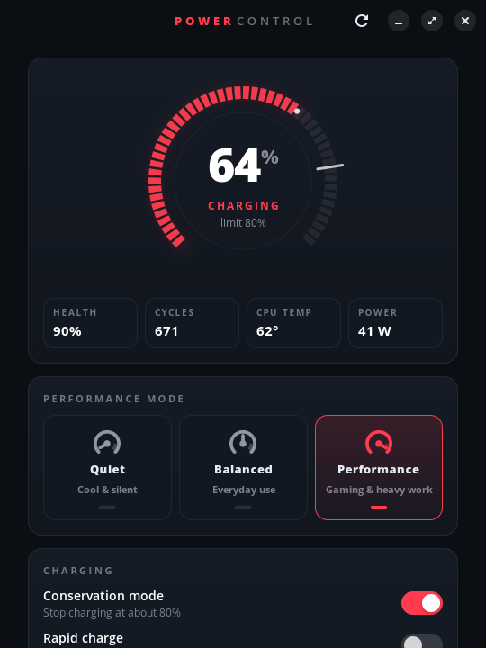

# lpowerd

[](https://github.com/mishabvibes/lpowerd/actions/workflows/tests.yml)
[](LICENSE)

Battery-care and performance-profile daemon for Lenovo IdeaPad, LOQ and Legion
laptops on Linux. Built and tested on a LOQ 15ARP9 (83JC) running Pop!_OS 24.04
with COSMIC.

<p align="center"></p>

> **Not affiliated with Lenovo.** This is an independent community project.
> "Lenovo", "LOQ", "Legion" and "IdeaPad" are trademarks of Lenovo, used here
> only to say which hardware it supports. lpowerd uses only standard Linux
> kernel interfaces and never changes power limits, fan curves or voltages.

- Conservation mode, rapid charge, and charge limits in percent
- **Heat guard**: rapid charge turns off, and charging pauses when the firmware
  allows it, while the laptop is hot
- **Scheduled full charge**: hold at the limit, then charge to 100% only inside a
  daily time window (for example 05:00–07:00, before you unplug)
- **One-shot full charge**: charge to 100% once, then go back to the limit
- Quiet / Balanced / Performance profiles, mapped to the Lenovo
  `platform_profile` handler
- No `sudo` for everyday use: it runs over D-Bus and Polkit
- Settings come back after suspend, hibernate and reboot
- **Settings app** (GTK4/libadwaita) in the app launcher, a tray icon in the
  COSMIC panel, and a CLI (`lpctl`) for scripts

## Architecture

```
 ┌──────────────────── user session ───────────────────┐
 │  lpowerd-gui (GTK4)   lpctl (CLI)   lpowerd-tray    │── session bus ──▶ COSMIC status area
 └────────┬───────────────────┬────────────────────────┘           (StatusNotifierWatcher)
          │   system D-Bus: io.github.lpowerd.Manager1
          ▼                   ▼
 ┌──────────────────────── lpowerd (root, systemd, sandboxed) ─────────────────────────┐
 │  D-Bus API ──▶ Polkit CheckAuthorization (charging / profile / configure)           │
 │      │                                                                              │
 │      ▼                                                                              │
 │  policy.decide()  ◀── settings (/var/lib/lpowerd/state.json, atomic writes)         │
 │   pure function:      + battery %, AC, temperature, clock                           │
 │   limit · schedule · thermal hysteresis · one-shot → {mode, inhibit, threshold}     │
 │      │                                                                              │
 │      ▼                                                                              │
 │  hardware.py: writes only when the value differs, then reads it back to check       │
 │                                                                                     │
 │  Wake sources (blocking poll, no timers while idle):                                │
 │   • kernel uevents (NETLINK)  – AC plug/unplug, battery status                      │
 │   • logind PrepareForSleep    – re-apply after resume / hibernate                   │
 │   • platform_profile POLLPRI  – Fn+Q hotkey changes                                 │
 │   • PPD PropertiesChanged     – profile changed from the COSMIC/GNOME power menu    │
 │   • timers ONLY when needed   – next schedule edge; 60 s poll on AC while a         │
 │                                 software limit, the thermal guard or one-shot runs  │
 └───────────────┬─────────────────────────────────────────────────────────────────────┘
                 ▼
  /sys/class/power_supply/BAT*/charge_types        (kernel ≥ 6.14: Fast|Standard|Long_Life)
  …/VPC2004:*/conservation_mode                    (older ideapad_laptop)
  …/legion/PNP0C09:*/rapidcharge                   (LenovoLegionLinux module)
  …/BAT*/charge_control_{start,end}_threshold      (if present: real % limits)
  …/BAT*/charge_behaviour                          (if present: inhibit-charge)
  /sys/class/platform-profile/*/profile            (lenovo-wmi-gamezone, ideapad)
  /sys/firmware/acpi/platform_profile              (legacy)
```

`/lib/systemd/system-sleep/lpowerd` calls `Reapply` after every resume as a backup
to the logind signal.

### How hardware is found

Nothing is hardcoded to a single path. `hardware.py` checks each layout in turn:

| Interface | Probed locations (first match wins) |
|---|---|
| ideapad (VPC2004) | `drivers/ideapad_acpi/VPC2004:*`, `drivers/ideapad_laptop/…`, `bus/platform/devices/VPC2004:*`, `devices/pci*/*/PNP0C09:*/VPC2004:*`, `devices/platform/VPC2004:*` |
| Battery | the first `power_supply` with `type=Battery` that is not `scope=Device` (so a wireless mouse battery is skipped) |
| Charge API | `charge_types` when the kernel has it; otherwise `conservation_mode` + Legion `rapidcharge`, never both |
| Profile | `platform-profile-*` with a Lenovo handler preferred, then the legacy ACPI file |
| Temperature | battery `temp`, then the battery's hwmon, then the CPU sensor (`k10temp`/`coretemp`, `acpitz` last) |

Run `lpctl detect` to see what was found on your machine.

### How charge limits work

Lenovo firmware usually offers only on/off conservation at a fixed level (about
80% on the LOQ). lpowerd uses the best method available:

| Limit you set | With a hardware threshold | With `inhibit-charge` | Conservation only (most IdeaPad/LOQ) |
|---|---|---|---|
| 100 | threshold 100 | auto | Standard / Fast |
| = floor (80) | threshold | — | conservation mode |
| floor–99 (e.g. 90) | threshold | software | **software**: charges normally, switches conservation on at 90%, and switches it off again below 87% |
| < floor | threshold | software (inhibit) | rejected; the firmware can't do it |

Rapid charge and conservation can't both be on, so turning one on turns the other off.

## Install

```bash
git clone https://github.com/mishabvibes/lpowerd.git
cd lpowerd
sudo ./install.sh
lpctl status
```

The installer puts the package in `/usr/lib/lpowerd` and the commands in
`/usr/bin`. It also installs the systemd unit, the D-Bus policy and activation
file, the Polkit policy, the sleep hook and an XDG autostart entry for the tray.
Then it enables the service and starts the tray for you. Dependencies are
`python3-dbus` and `python3-gi`; both ship with Pop!_OS.

On the first start the daemon **adopts the current firmware state**, so if
conservation is already on it stays on.

Uninstall: `sudo ./install.sh --uninstall` (add `--purge` to also delete your
settings).

## Usage

### Settings window

Open **Power Control** from the app launcher, or click the gauge icon in the
panel and choose *Open Power Control…*.

The window is a dark hardware-dashboard. Its accent colour follows the active
profile the same way the power-button LED does: blue for Quiet, white for
Balanced, red for Performance. It turns orange while the heat guard is active.
The animated battery ring marks the charge limit. Animations run only while
something changes, or while charging with the window focused, so an idle
window draws nothing. The ring is drawn with GTK's GPU path API (GTK ≥ 4.14),
so no cairo bindings are needed.

| Section | What it does |
|---|---|
| Battery | charge %, status, health, temperature, power draw (updates live) |
| Charging | Conservation mode, Rapid charge, Charge limit slider, *Charge now* (100% once) |
| Performance mode | Quiet · Balanced · Performance (follows Fn+Q) |
| Scheduled full charge | Charge to 100% only between two times each day |
| Temperature guard | Pause/slow charging above a temperature, resume below another |

A banner at the top appears when the daemon is not running, the guard has
tripped, or the firmware rejected a setting. Nothing needs a password.

### Command line

```bash
lpctl                          # same as: lpctl status
lpctl status --json
lpctl conservation on          # firmware cap (~80%)
lpctl set-threshold 90         # software limit (see table above)
lpctl set-threshold 100        # no limit
lpctl rapid-charge on
lpctl full-once                # 100% once, then back to the limit
lpctl schedule 05:00-07:00     # 100% only inside this window (can cross midnight)
lpctl schedule off
lpctl thermal on               # automatic trip points
lpctl thermal on --high 80 --low 70
lpctl profile                  # list profiles
lpctl profile quiet|balance|performance
lpctl monitor                  # live status changes
lpctl reapply                  # re-detect hardware and re-apply settings
lpctl detect                   # hardware probe, no daemon needed
```

Polkit rules: every action needs **no password** for the user at the active
local session (remote or inactive sessions must authenticate as admin). To
lock down schedules and the thermal guard, set `io.github.lpowerd.configure`
to `auth_admin_keep` in
`/usr/share/polkit-1/actions/io.github.lpowerd.policy` or add a rule in
`/etc/polkit-1/rules.d/`.

### Tray

`lpowerd-tray` implements StatusNotifierItem and `com.canonical.dbusmenu`
directly. It doesn't need libappindicator or GTK, so it appears in the COSMIC
panel's status area, KDE, waybar, and GNOME with the AppIndicator extension. The
menu has battery and temperature info, Conservation and Rapid charge toggles,
"Charge to 100% once", a Profile submenu and *Open Power Control…*. The icon
is a gauge showing the active profile (deliberately not a battery icon, since
the desktop already shows one), and turns into a warning while the heat guard
is active.

## Heat guard: what it can and can't do

The LOQ 15ARP9 has **no battery temperature sensor**. lpowerd falls back to the
CPU temperature and labels it as such. The battery pack's own overheat
protection keeps working either way; the heat guard only ever makes charging
gentler. The default trip points are 85 °C to trip and 75 °C to resume for the
CPU sensor, and 45/40 °C for a real battery sensor. When the guard trips:

1. Rapid charge is switched off.
2. If the kernel has `inhibit-charge`, charging stops.
3. Otherwise, if the battery is at or above the conservation level, conservation
   mode is switched on, which stops charging.
4. Below that level the battery keeps charging at Standard speed. These
   firmwares have no way to stop charging there.

## D-Bus API

Bus name `io.github.lpowerd`, object `/io/github/lpowerd`, interface
`io.github.lpowerd.Manager1`:

| Member | Signature | Polkit action |
|---|---|---|
| `GetStatus()` | `→ s` (JSON) | — |
| `Reapply()` | | — |
| `SetChargeLimit(u)` | | `…charging` |
| `SetConservation(b)` | | `…charging` |
| `SetRapidCharge(b)` | | `…charging` |
| `ChargeFullOnce()` | | `…charging` |
| `SetProfile(s)` | quiet/balance/performance or a raw value | `…profile` |
| `SetSchedule(ss)` | `"HH:MM","HH:MM"`, or `"",""` to clear | `…configure` |
| `SetThermalGuard(bdd)` | enabled, high, low (0 = auto) | `…configure` |
| signal `StatusChanged(s)` | JSON | |

```bash
busctl --system call io.github.lpowerd /io/github/lpowerd io.github.lpowerd.Manager1 GetStatus
```

## Coexisting with other tools

- **system76-power / power-profiles-daemon**: profile changes go through
  `net.hadess.PowerProfiles` first, so the desktop power menu stays in sync.
  lpowerd then writes `platform_profile` directly if the provider did not.
  Changes made from the desktop menu or with Fn+Q are picked up and remembered.
- **Extreme / Custom modes**: some kernels advertise `max-power` and `custom`
  even on models where Lenovo's own software does not offer them (the LOQ is
  one). lpowerd hides them. Set `"advanced_profiles": true` in
  `/var/lib/lpowerd/state.json` and restart the service to show them anyway.
- **TLP / auto-cpufreq**: if they also set charge thresholds they will fight
  with lpowerd. Turn off their battery options. The installer warns you if
  either one is running.
- **LenovoLegionLinux**: its `rapidcharge` attribute is used when the kernel has
  no `charge_types`.

## Development

```bash
python3 -m unittest -v tests/test_lpowerd.py

# Run the whole stack unprivileged against a fake sysfs tree on the session bus:
python3 -c "import sys; sys.path.insert(0,'tests'); from test_lpowerd import make_tree; make_tree('/tmp/fake')"
./bin/lpowerd --session --sysfs-root /tmp/fake --state /tmp/state.json -v &
LPOWERD_BUS=session ./bin/lpctl status
LPOWERD_BUS=session ./bin/lpowerd-tray &
LPOWERD_BUS=session ./bin/lpowerd-gui
LPOWERD_BUS=session LPOWERD_GUI_SHOT=/tmp/gui.png ./bin/lpowerd-gui   # render to PNG and exit
```

## File tree

```
lpowerd/
├── install.sh                      install / --uninstall [--purge]
├── bin/{lpowerd,lpctl,lpowerd-tray,lpowerd-gui}
├── lpowerd/
│   ├── __init__.py                 names, profile aliases
│   ├── hardware.py                 detection engine + sysfs I/O
│   ├── policy.py                   pure charging policy
│   ├── state.py                    persistent settings (atomic JSON)
│   ├── uevent.py                   netlink uevent listener
│   ├── daemon.py                   D-Bus service, Polkit, event loop
│   ├── cli.py                      lpctl
│   ├── gui.py                      GTK4/libadwaita dashboard window
│   └── tray.py                     StatusNotifierItem + dbusmenu applet
├── data/
│   ├── systemd/lpowerd.service     Type=dbus, sandboxed, no capabilities
│   ├── dbus/io.github.lpowerd.{conf,service}
│   ├── polkit/io.github.lpowerd.policy
│   ├── system-sleep/lpowerd
│   ├── autostart/lpowerd-tray.desktop
│   └── applications/io.github.lpowerd.Gui.desktop
└── tests/test_lpowerd.py
```

## License

Copyright (C) 2026 mishabvibes

lpowerd is free software: you can redistribute it and/or modify it under the
terms of the GNU General Public License version 3 or (at your option) any later
version. See [LICENSE](LICENSE).
